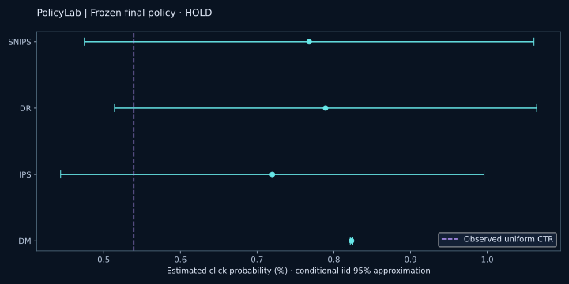

# PolicyLab — Can logged clicks justify a policy change?

**Ruturajsinh Zala · Root2Raj** | AI-assisted personal Data Science + Data Architecture research

[](https://github.com/Root2Raj-Zala/root2raj-policylab/actions/workflows/verify.yml)

[Interactive evidence lab](https://root2raj.ruturaj1zala123.chatgpt.site/projects/policylab/) · [Kaggle notebook](https://www.kaggle.com/code/ruturajsinhzala/root2raj-policylab) · [Model card](docs/MODEL_CARD.md) · [Frozen protocol](protocol.json)

A recommender changes which outcomes are observed. PolicyLab evaluates that problem with **4,530,676 actual ZOZOTOWN recommendation impressions**, immutable source hashes, a replayable Parquet/DuckDB warehouse and four off-policy estimators. It includes a useful negative result: **HOLD**.

## What the evidence says

- Complete Random/Men and BTS/Men logs: 452,949 + 4,077,727 impressions, 34 actions, seven days in November 2019. Counts match the publisher's Table 1.
- The first-position reference comparison implements official production-prior Bernoulli Thompson Sampling using 1,000,000 draws. Algorithm parity passes, but the observed BTS policy does not match this fixed-prior reference closely enough. This discrepancy is surfaced, not optimized away.
- A distinct 4-day train / 1-day selection / 2-day final study freezes `action_epsilon_0.5` before final scoring. On 41,536 final rows, DR estimates 0.7892% click probability. The paired difference against uniform is 0.2512 percentage points with a conditional interval crossing zero. **No successful uplift or deployment claim.**
- DM, IPS, SNIPS and DR; ESS and tail diagnostics; predeclared clipping sensitivity; paired uncertainty; UTC-hour bootstrap sensitivity; a separate 500-replicate synthetic oracle study.
- Thirty tests cover estimator identities, misspecification, bad probabilities, missing overlap, future outcomes, model fallback, timestamp precision, duplicate preservation and interrupted-commit recovery. Real-audit reconciliation and a complete real-source replay are separate evidence checks.



## Inspect the evidence

| Concern | Artifact |
|---|---|
| Selection before final scoring | [Selection receipt](artifacts/selection.json) |
| Reference mismatch | [Review](artifacts/reference-review.json), [action diagnostics](artifacts/reference-action-diagnostics.csv) |
| Estimation and uncertainty | [Metrics](artifacts/metrics.json), [protocol](docs/PROTOCOL.md) |
| Real-source replay | [Recovery receipt](artifacts/replay.json), [shard ledger](artifacts/shard-ledger.csv) |
| Source and output integrity | [Source manifest](artifacts/source-manifest.json), [hashes](artifacts/integrity.json) |
| Known-answer simulations | [Summary](artifacts/simulation-summary.csv) |
| Reproduction | [Instructions](docs/REPRODUCIBILITY.md), [notebook](notebooks/policylab.ipynb) |
| Architecture | [ADRs and runbook](docs/ARCHITECTURE.md), [SQL marts](queries.sql) |
| Explain the work | [Plain-language walkthrough](docs/EXPLAIN_THIS_PROJECT.md) |

## Run

Use a free local CPU. Follow [the platform-specific instructions](docs/REPRODUCIBILITY.md), install requirements, then:

```bash
python -m unittest discover -s tests -v
python scripts/download.py
python scripts/run.py
python scripts/finalize.py
```

The full-source benchmark downloads about 1.485GB and builds bounded 100,000-row shards. CI and the default Kaggle notebook audit the frozen real held-out evidence and execute the scientific/recovery tests; they do not silently claim a fresh full-source run. The notebook exposes an optional full-source rerun. Raw files stay outside Git. Source audit data is available in the self-contained notebook package and on GitHub as `artifacts/test-audit.csv.gz`.

## Limits that matter

Marginal item-position propensities cannot identify arbitrary slate interactions. User-feature hashes are not user IDs. Only seven source days exist. Monte Carlo propensities, unresolved reference alignment, short-horizon dependence and unavailable feature vintages limit inference. A click estimate is not commercial profit. The project does not establish independent coding proficiency, client experience or operational infrastructure.

## Attribution and licenses

Saito, Y., Aihara, S., Matsutani, M., & Narita, Y. *Open Bandit Dataset and Pipeline: Towards Realistic and Reproducible Off-Policy Evaluation* (2021). [Paper](https://arxiv.org/abs/2008.07146), [official data](https://research.zozo.com/data.html), [official hosting](https://huggingface.co/datasets/zozonext/open-bandit), [reference code](https://github.com/st-tech/zr-obp). Data and transformed audit/aggregates: CC BY 4.0. Original implementation: MIT. Reference priors/code: Apache 2.0, preserved in [NOTICE](NOTICE). Transformations include filtering position one, empirical-Bayes fitting, policy weighting and aggregation. No upstream endorsement.

DR background: [Dudik, Langford & Li (2011)](https://arxiv.org/abs/1103.4601). No global novelty or salary outcome is claimed. All work uses free local/public tooling; no paid API.
