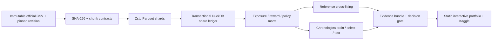

# Architecture and recovery runbook

**ADR 1: CPU and local storage.** Two DuckDB threads, 1GB DuckDB memory limit and 100,000 CSV rows per chunk. Complete original rows and all source context columns persist in Parquet. Warehouse is local single-writer research infrastructure, not a multi-node production service. File chunks are physical ingestion partitions; the day column enables explicit analytical date filters. No claim of physical day partitioning.

**ADR 2: identity.** The ingestion key is the source-file SHA-256 plus original zero-based row offset. The exported CSV index is not trusted as a user/event ID. Equal-valued source records remain distinct. Anonymized contexts never become customer IDs.

**ADR 3: visibility protocol.** Write a pending Parquet shard, hash it, atomically rename it, then insert its row in a DuckDB transaction. Readers only open ledger-listed paths. Crash after rename but before ledger commit leaves an invisible orphan; rerun deterministically overwrites that path and commits it. Crash after commit is handled by the primary key and replay skip. Do not change chunk size within a source revision. This implements exactly-once *committed file visibility* in a single local writer, not globally exactly-once delivery. Multiple concurrent writers are unsupported.

**Recovery.** Close the failed process, preserve raw files and ledger, rerun `python scripts/run.py`. Never manually add orphan shards to the ledger. Do not delete legitimate identical rows. Restore from pinned data if hashes differ. Run the integrity audit to compare every ledger shard hash and row/click total with the batch marts. Recovery tests inject failure before commit, resume and redeliver. A full real-source replay records identical row, click and identity aggregates.

**SQL marts.** `exposures` contains logged action, context, time and marginal propensity. `rewards` projects source identity plus observed click. `logged_policies` aggregates policy, position and action. Each evidence run stores protocol/model/selection/source hashes. `queries.sql` independently queries those relations after opening their manifest-listed Parquet files. SQL views are recreated per connection from the ledger; they are not persistent external-path catalog entries.

**Operations.** No network service or customer data is collected. Source downloads require Internet; analysis and browser evidence work locally afterwards. Retain raw CC BY data outside Git. Published audit includes logged item/reward evidence and hashed source-row identities; it excludes user-feature hashes. Website serves aggregates and downloads with no analytics collector or paid API.
